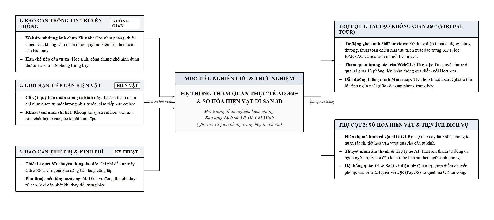

# CHƯƠNG 1. TỔNG QUAN ĐỀ TÀI

## 1.1. Bối cảnh đề tài và lý do lựa chọn

### 1.1.1. Nhu cầu ứng dụng công nghệ không gian 360° và mô hình 3D trên nền web
Mục tiêu nghiên cứu cốt lõi của nhóm khi thực hiện đề tài khóa luận tốt nghiệp là nghiên cứu và làm chủ hai công nghệ đồ họa tương tác hiện đại trên nền tảng web:
- **Công nghệ không gian toàn cảnh thực tế ảo 360 độ (Virtual Tour 360°):** Tái tạo không gian môi trường đa chiều từ một vị trí quan sát cố định. Người xem có thể sử dụng chuột trên máy tính hoặc thao tác chạm vuốt trên màn hình điện thoại để xoay nhìn tự do bốn hướng (trái, phải, trên, dưới), đồng thời nhấp chọn các điểm chuyển phòng (Hotspots) để di chuyển qua lại giữa các không gian như đang bước đi trong thực tế.
- **Công nghệ hiển thị và tương tác mô hình vật thể ba chiều (3D Models):** Cho phép người xem tiếp cận trực tiếp với vật thể trong không gian số, tự do xoay lật đa chiều, phóng to, thu nhỏ để quan sát tỉ mỉ từng chi tiết hình học, chất liệu và hoa văn bề mặt.

Khảo sát trên internet hiện nay cho thấy, phần lớn các trang web giới thiệu di sản, danh lam thắng cảnh và cơ sở văn hóa vẫn chủ yếu sử dụng ảnh chụp 2D tĩnh kèm các đoạn văn bản mô tả phẳng. Cách tiếp cận truyền thống này bộc lộ những hạn chế rõ rệt:
- *Về mặt không gian:* Ảnh chụp 2D cố định góc máy khiến người xem bị giới hạn tầm nhìn, không thể cảm nhận được chiều sâu không gian, tỷ lệ khoảng cách và hướng di chuyển trong một quần thể kiến trúc rộng lớn.
- *Về mặt hiện vật:* Ảnh chụp một mặt chỉ phản ánh được một góc chụp đơn lẻ, người xem không thể xoay chuyển để quan sát các góc khuất, các mặt bên hoặc hoa văn chạm khắc ở phía sau hiện vật.

### 1.1.2. Lý do lựa chọn Bảo tàng Lịch sử TP.HCM làm đối tượng thực nghiệm
Để ứng dụng công nghệ không gian 360 độ và mô hình 3D vào giải quyết một bài toán thực tế có độ phức tạp cao, nhóm đã lựa chọn Bảo tàng Lịch sử TP. Hồ Chí Minh (Số 2 Nguyễn Bỉnh Khiêm, Phường Bến Nghé, Quận 1) làm đối tượng nghiên cứu và thực nghiệm. Bảo tàng là một môi trường ứng dụng hoàn hảo vì hội tụ đầy đủ hai bài toán kỹ thuật mà đề tài hướng đến:
- **Về bài toán không gian kiến trúc:** Bảo tàng có quy mô lớn với 18 phòng trưng bày nối tiếp nhau theo một lộ trình tham quan khép kín, lưu giữ tiến trình lịch sử Việt Nam từ thời Tiền sử đến triều Nguyễn cùng các nền văn hóa cổ phương Nam. Việc xây dựng một chuyến tham quan ảo 360 độ kết hợp sơ đồ bản đồ thu nhỏ (Mini-map) sẽ giúp học sinh, sinh viên và khách tham quan từ xa có thể hình dung rõ ràng lộ trình, vị trí từng phòng và tự do trải nghiệm bước đi qua từng thời kỳ lịch sử.
- **Về bài toán hiện vật số hóa:** Bảo tàng hiện lưu giữ hàng ngàn cổ vật quý báu. Để bảo đảm an toàn chống xuống cấp vật lý do nhiệt độ, ánh sáng và tiếp xúc cơ học, toàn bộ các cổ vật này đều được đặt sau các tủ kính dày và khách tham quan tuyệt đối không được chạm tay vào. Ngay cả khi đến xem trực tiếp tại chỗ, người xem cũng chỉ nhìn được từ một phía. Việc đưa mô hình 3D của cổ vật lên trang web giúp người xem có thể phóng to, xoay lật 360 độ để chiêm ngưỡng trọn vẹn từng đường nét hoa văn tinh xảo ở mọi góc cạnh mà ngoài đời thực không thể thấy được.

Bên cạnh đó, việc tạo lập các chuyến tham quan ảo hiện nay thường đòi hỏi các thiết bị quét 3D chuyên dụng đắt tiền (như máy quét laser hoặc máy ảnh 360 độ chuyên nghiệp) và phụ thuộc vào nền tảng đám mây đóng có thu phí định kỳ của nước ngoài. Khi bảo tàng thay đổi bài trí hiện vật hoặc mở thêm chuyên đề trưng bày mới, việc thuê lại dịch vụ quét ngoài rất tốn kém và mất nhiều thời gian. Do đó, đề tài phát triển thêm công cụ xử lý ảnh tự động từ video quay bằng điện thoại thông minh thông thường, giúp ban quản trị bảo tàng có thể tự chủ cập nhật không gian phòng trưng bày trên hệ thống máy chủ riêng mà không bị phụ thuộc vào thiết bị đắt tiền bên ngoài.

\

*Hình 1.1: Sơ đồ tư duy bối cảnh đề tài và giải pháp kết hợp Không gian 360° – Mô hình hiện vật 3D*

\

---

## 1.2. Mục tiêu nghiên cứu và phạm vi triển khai

### 1.2.1. Mục tiêu tổng quát và các mục tiêu cụ thể của hệ thống
- **Mục tiêu tổng quát:**  
  Nghiên cứu, thiết kế và xây dựng hoàn chỉnh *"Hệ thống Tham Quan Thực Tế Ảo 360° & Số Hóa Không Gian Di Sản Bảo Tàng Lịch Sử TP.HCM"*, hoạt động ổn định trên nền tảng web (tương thích máy tính và thiết bị di động), phục vụ nhu cầu tham quan trực quan cho công chúng và cung cấp công cụ quản trị số hóa linh hoạt cho đơn vị quản lý.

- **Các mục tiêu cụ thể:**  
  1. *Làm chủ thuật toán xử lý ảnh 360 độ:* Xây dựng đường ống (pipeline) xử lý ảnh tự động trên nền Python OpenCV, tiếp nhận video quay phòng bằng điện thoại di động thông thường, trích xuất khung hình rõ nét, nắn phẳng chiếu mặt trụ (Cylindrical Warping), tìm điểm tương đồng bằng SIFT, ước lượng ma trận Homography kết hợp RANSAC và hòa trộn mí nối liền mạch để xuất ra ảnh toàn cảnh 360 độ chuẩn tỷ lệ 2:1.
  2. *Xây dựng cổng tham quan tương tác 360° & Cổ vật 3D:* Ứng dụng thư viện Three.js và WebGL để kết xuất không gian cầu mượt mà; gắn các điểm chuyển phòng (Hotspots), tích hợp bản đồ nhỏ (Mini-map) có khả năng tìm đường đi ngắn nhất giữa 18 phòng theo thuật toán Dijkstra, kết xuất mô hình 3D cổ vật (.GLB) cho phép xoay phóng tương tác, phát thuyết minh âm thanh đa ngôn ngữ và tích hợp trợ lý hỏi đáp kiến thức lịch sử.
  3. *Hiện thực hóa phân hệ quản trị Studio & Soát vé QR:* Cung cấp công cụ quản trị trực quan trên web để ban quản lý có thể tải ảnh/video phòng mới, ghim điểm chuyển phòng trực tiếp trên mặt cầu 360 độ, quản lý thông tin cổ vật; đồng thời tích hợp cổng thanh toán VietQR (PayOS) và phân hệ camera quét mã QR trên điện thoại để nhân viên bảo tàng soát vé khách vào cổng.

### 1.2.2. Đối tượng nghiên cứu và phạm vi thực nghiệm tại 18 gian phòng trưng bày
- **Đối tượng nghiên cứu:**  
  - Nguyên lý chiếu mặt trụ (Cylindrical Warping) và biểu diễn không gian toàn cảnh Equirectangular Projection.
  - Thuật toán trích xuất đặc trưng bất biến SIFT và thuật toán ước lượng ma trận Homography kết hợp lọc nhiễu RANSAC.
  - Kỹ thuật kết xuất đồ họa không gian ba chiều trên nền web thông qua WebGL và Three.js.
  - Kiến trúc phân tầng kết hợp hàng đợi xử lý bất đồng bộ (Redis Queue) giữa máy chủ Node.js Express và dịch vụ xử lý ảnh Python.

- **Phạm vi thực nghiệm:**  
  - *Không gian kiến trúc:* Thực nghiệm số hóa toàn bộ 18 gian phòng trưng bày thuộc hệ thống tham quan chính thức của Bảo tàng Lịch sử TP.HCM, bao gồm: Phòng Thời Tiền sử, Thời dựng nước Hùng Vương, Thời Bắc thuộc, Văn hóa Champa, Văn hóa Óc Eo - Phù Nam, Các triều đại Ngô - Đinh - Tiền Lê, Lý, Trần, Hậu Lê, Tây Sơn, Triều Nguyễn và các bộ sưu tập mỹ thuật cổ.
  - *Hiện vật số hóa:* Thu thập và tích hợp mô hình 3D của các cổ vật tiêu biểu đại diện cho các thời kỳ văn hóa lịch sử, phục vụ tương tác trực quan trên trình duyệt.
  - *Môi trường thử nghiệm:* Hệ thống được triển khai thực nghiệm trên máy chủ đám mây (Cloud VPS), kiểm thử hiệu năng truy cập trên các trình duyệt phổ biến (Google Chrome, Safari, Microsoft Edge) trên cả máy tính xách tay và thiết bị di động (hệ điều hành Android và iOS).

---

## 1.3. Phương pháp tiếp cận và cấu trúc báo cáo

### 1.3.1. Tiến trình khảo sát, thu thập dữ liệu và thử nghiệm qua 4 đợt tác nghiệp thực tế
Để đảm bảo hệ thống phản ánh đúng thực tế không gian kiến trúc và vận hành ổn định khi đưa vào sử dụng, toàn bộ dữ liệu số hóa và quy trình kiểm thử phần mềm đều được nhóm trực tiếp thực hiện qua **4 đợt tác nghiệp thực tế** tại Bảo tàng Lịch sử TP. Hồ Chí Minh:

- **Đợt 1 (Khảo sát hiện trạng không gian và thiết lập sơ đồ liên thông các phòng):**  
  Nhóm trực tiếp đến bảo tàng khảo sát toàn bộ khuôn viên và kiến trúc liên hoàn của 18 phòng trưng bày (từ thời Tiền sử, dựng nước Hùng Vương, các triều đại phong kiến đến văn hóa Champa và Óc Eo). Nhóm ghi nhận cụ thể cấu trúc các cửa thông phòng (cửa nào dẫn sang phòng nào) để làm cơ sở xây dựng sơ đồ đồ thị cho thuật toán tìm đường đi ngắn nhất (Dijkstra) và định vị các biểu tượng mũi tên chuyển phòng. Đồng thời, nhóm ghi chú vị trí các tủ kính trưng bày cổ vật quý và khảo sát điều kiện ánh sáng thực tế (nhiều phòng ánh sáng tự nhiên yếu, sử dụng đèn rọi vàng chiếu thẳng vào tủ kính dễ gây lóa khi chụp ảnh).

- **Đợt 2 (Thử nghiệm kỹ thuật quay chụp bằng điện thoại và tối ưu thuật toán xử lý ảnh):**  
  Nhóm sử dụng điện thoại thông minh thử nghiệm các thao tác quay video lia máy 360 độ và chụp ảnh ở chế độ góc siêu rộng (0.5x) tại một số gian phòng đại diện. Khi đưa dữ liệu vào thử nghiệm trên bộ công cụ xử lý ảnh (thư viện OpenCV), nhóm đã phát hiện và từng bước khắc phục các lỗi kỹ thuật phát sinh trong thực tế: hiện tượng lệch mí nối góc tường khi lia máy không đều tay, tình trạng dính bóng chân người chụp ở khu vực đáy sàn nhà, và ảnh bị chói lóa tại các điểm có đèn rọi trực tiếp. Kết quả thử nghiệm giúp nhóm hoàn thiện thuật toán làm mịn vùng sàn, cân bằng ánh sáng trong nhà và xây dựng quy chuẩn quay video quét phòng chuẩn xác (đứng quay chậm tại tâm phòng, lia đều tay 360 độ theo phương ngang).

- **Đợt 3 (Thu thập chính thức dữ liệu không gian 18 phòng và tư liệu cổ vật 3D):**  
  Tiến hành ghi hình dữ liệu quét toàn cảnh chuẩn cho toàn bộ 18 gian phòng trưng bày theo quy trình đã thử nghiệm thành công ở Đợt 2. Đồng thời, nhóm chụp ảnh chi tiết đa góc các cổ vật tiêu biểu của từng thời kỳ lịch sử (như tượng đá Champa, gốm men Lý - Trần, trang phục cung đình triều Nguyễn) phục vụ việc tái tạo mô hình vật thể ba chiều (định dạng 3D GLB). Nhóm cũng thu thập đầy đủ tư liệu lịch sử, bảng giới thiệu tại chỗ để làm nội dung cho hệ thống thuyết minh âm thanh đa ngôn ngữ và dữ liệu tri thức phục vụ trợ lý ảo thông minh.

- **Đợt 4 (Thực nghiệm hệ thống trên môi trường thực tế tại khuôn viên bảo tàng):**  
  Sau khi hoàn thiện và triển khai toàn bộ hệ thống lên máy chủ trực tuyến (Cloud VPS), nhóm mang thiết bị di động trực tiếp xuống bảo tàng để trải nghiệm và kiểm thử với tư cách người tham quan thực tế: kiểm tra tốc độ tải các không gian 360 độ và mô hình 3D trên kết nối mạng di động 4G tại khuôn viên; thử nghiệm luồng mua vé trực tuyến qua cổng thanh toán VietQR (PayOS) và sử dụng camera điện thoại quét mã QR soát vé tại cửa ra vào để kiểm tra độ nhạy và tính chính xác; đối chiếu sơ đồ bản đồ thu nhỏ (Mini-map) trên web với lộ trình đi lại thực tế của bảo tàng để tinh chỉnh các mũi tên chuyển phòng và hướng nhìn mặc định sao cho trực quan, khớp với thực địa.

*(Hình ảnh tác nghiệp thực tế của nhóm sinh viên tại Bảo tàng Lịch sử TP.HCM sẽ được chèn trực tiếp vào mục này khi nhóm cung cấp ảnh chụp).*

### 1.3.2. Bố cục tổng thể của báo cáo khóa luận
Nội dung cuốn báo cáo khóa luận tốt nghiệp được cấu trúc chặt chẽ thành 5 chương chính theo đúng tiến trình nghiên cứu và phát triển hoàn chỉnh của một hệ thống công nghệ thông tin, từ khảo sát thực tế, nghiên cứu lý thuyết, phân tích thiết kế cho đến hiện thực hóa phần mềm và đánh giá thực nghiệm:

- **Chương 1: Tổng quan đề tài**  
  Trình bày bối cảnh thực tế tại Bảo tàng Lịch sử TP.HCM, các thách thức về kinh phí thiết bị, mục tiêu nghiên cứu, phạm vi triển khai tại 18 gian phòng trưng bày và tiến trình 4 đợt tác nghiệp thực địa của nhóm sinh viên.

- **Chương 2: Cơ sở lý thuyết và các công nghệ nền tảng**  
  Nghiên cứu nguyên lý toán học của bài toán tạo ảnh toàn cảnh 360 độ từ video quay thông thường (nắn phẳng mặt trụ, trích xuất đặc trưng RootSIFT, ước lượng Homography lọc nhiễu qua RANSAC và hòa trộn đa băng tần Laplacian); khảo sát các phương pháp tái tạo mô hình hiện vật 3D (phương pháp nội suy hình học thể tích Heuristic CPU và mô hình khuếch tán AI TRELLIS GPU); cùng kiến trúc lưu trữ lai PostgreSQL – MongoDB – Redis và mô hình ngôn ngữ lớn Google Gemini.

- **Chương 3: Khảo sát hiện trạng và phân tích yêu cầu hệ thống**  
  Tổng hợp kết quả khảo sát thực tế cấu trúc không gian 18 gian phòng trưng bày liên hoàn; xác định các nhóm tác nhân (khách tham quan, ban quản trị, nhân viên soát vé); phân tích chi tiết các yêu cầu chức năng và phi chức năng; xây dựng sơ đồ ca sử dụng tổng quát (Use Case Diagram) và bảng phân loại nghiệp vụ.

- **Chương 4: Hiện thực hóa và đánh giá thực nghiệm**  
  Mô tả chi tiết kết quả hiện thực hóa 5 phân hệ chức năng cốt lõi dựa trên mã nguồn thực tế (Xưởng ghép ảnh 360°, Cổng tham quan Three.js & Mini-map Dijkstra, Trình tương tác Cổ vật 3D Đa Động cơ, Quản trị CMS Nhận diện thương hiệu, Đặt vé trực tuyến VietQR và Soát vé Camera QR di động); đồng thời công bố kết quả thực nghiệm qua 4 đợt tác nghiệp tại bảo tàng, bảng so sánh chuyên sâu giữa hai động cơ 3D và các số liệu đo lường hiệu năng FPS, RAM, thời gian tải trên mạng di động 4G.

- **Chương 5: Kết luận và hướng phát triển**  
  Tổng kết toàn diện các kết quả khoa học và giá trị thực tiễn bảo tồn di sản chi phí 0 đồng của đề tài; thẳng thắn nhìn nhận những điểm còn hạn chế kỹ thuật và đề xuất các định hướng nâng cấp tiềm năng trong tương lai (WebXR trên kính thực tế ảo và công nghệ 3D Gaussian Splatting).
