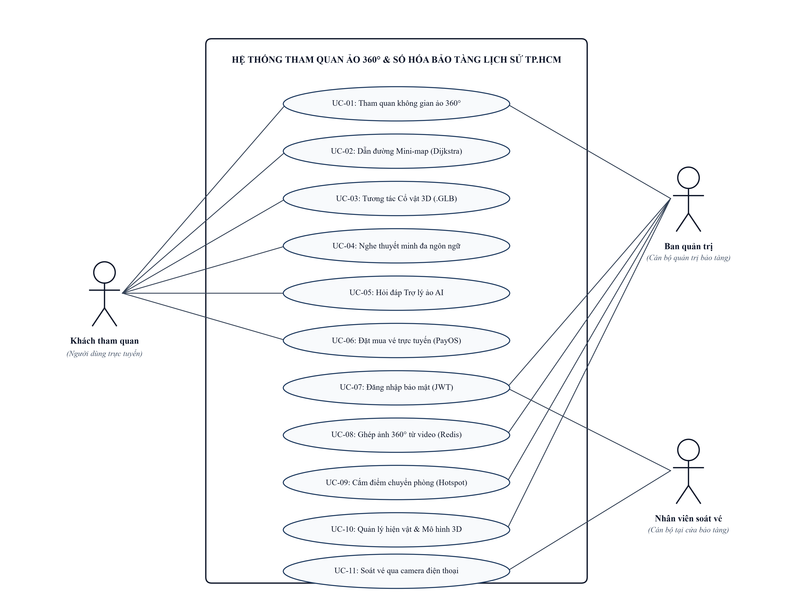

# CHƯƠNG 3. KHẢO SÁT HIỆN TRẠNG VÀ PHÂN TÍCH YÊU CẦU HỆ THỐNG

Chương này trình bày toàn bộ kết quả khảo sát thực địa tại Bảo tàng Lịch sử TP. Hồ Chí Minh qua 4 đợt tác nghiệp của nhóm sinh viên; phân loại các nhóm tác nhân tham gia vào hệ thống; và phân tích chi tiết các yêu cầu chức năng, yêu cầu phi chức năng cùng mô hình ca sử dụng tổng quát của hệ thống phần mềm.

---

## 3.1. Khảo sát hiện trạng không gian và quy trình nghiệp vụ tại bảo tàng

### 3.1.1. Hiện trạng kiến trúc và không gian trưng bày 18 gian phòng
Bảo tàng Lịch sử TP. Hồ Chí Minh (tọa lạc tại số 2 đường Nguyễn Bỉnh Khiêm, phường Bến Nghé, Quận 1) là một trong những công trình di sản kiến trúc tiêu biểu của thành phố, sở hữu khuôn viên rộng lớn và hệ thống 18 gian phòng trưng bày liên hoàn:
- **Cấu trúc mặt bằng liên hoàn:** Các gian phòng được xây dựng kết nối tiếp nối nhau tạo thành một chu trình khép kín bao quanh sân trong. Khách tham quan di chuyển tuần tự qua các thời kỳ lịch sử dân tộc: từ Thời Tiền sử, Dựng nước Hùng Vương, Thời kỳ đấu tranh giành độc lập (thế kỷ I – X), các triều đại phong kiến độc lập (Ngô – Đinh – Tiền Lê, Lý, Trần, Hậu Lê, Tây Sơn, Triều Nguyễn) cho đến các phòng chuyên đề đặc biệt như Văn hóa Champa, Văn hóa Óc Eo – Phù Nam và Nghệ thuật Phật giáo Châu Á.
- **Vấn đề điều hướng thực tế:** Do diện tích bảo tàng lớn, các gian phòng có nhiều cửa thông phòng đối xứng nhau và các hành lang dài, khách tham quan trực tiếp (đặc biệt là khách quốc tế và các đoàn học sinh) thường gặp khó khăn trong việc định hình lộ trình tham quan, dễ bỏ sót các gian phòng trưng bày ở góc khuất hoặc đi ngược thứ tự tiến trình lịch sử.
- **Nhu cầu số hóa không gian:** Việc xây dựng một sơ đồ bản đồ thu nhỏ (Mini-map) có khả năng định vị vị trí phòng hiện tại và chỉ dẫn đường đi ngắn nhất giữa hai phòng bất kỳ là một yêu cầu cấp thiết để nâng cao trải nghiệm tham quan từ xa lẫn hỗ trợ khách đến bảo tàng.

*Hình 3.1: Sơ đồ mặt bằng liên hoàn 18 gian phòng trưng bày tại Bảo tàng Lịch sử TP.HCM*

### 3.1.2. Hiện trạng bảo quản cổ vật và hạn chế của không gian trưng bày vật lý
Bảo tàng hiện đang lưu giữ và bảo tồn hơn 40.000 hiện vật lịch sử quý giá, trong đó có nhiều bảo vật quốc gia phản ánh diện mạo văn hóa đa dạng của vùng đất Nam Bộ và lịch sử dân tộc [16]:
- **Hạn chế của tủ kính bảo vệ:** Để đảm bảo an toàn tuyệt đối trước các tác động của môi trường và con người, hầu hết các cổ vật quý (như tượng đá thế kỷ VII, đồ gốm men lam, vũ khí kim loại cổ) đều được niêm phong nghiêm ngặt trong các tủ kính chuyên dụng hoặc được đặt sát vách tường. Khách tham quan chỉ có thể quan sát hiện vật từ một góc nhìn duy nhất ở mặt trước, không thể đi vòng ra phía sau hoặc ngắm nhìn cận cảnh các đường nét hoa văn chạm khắc tinh xảo.
- **Rào cản về trải nghiệm tương tác:** Quy định an ninh bảo tàng tuyệt đối cấm người xem chạm tay vào hiện vật. Điều này tạo ra một rào cản vô hình đối với việc tiếp cận thông tin chuyên sâu của học sinh, sinh viên và các nhà nghiên cứu lịch sử.
- **Đặc thù chiếu sáng:** Không gian trưng bày trong bảo tàng sử dụng hệ thống đèn rọi vàng cục bộ để tôn vinh hiện vật, đồng thời mặt kính tủ trưng bày tạo ra nhiều vệt phản quang. Đây là thách thức kỹ thuật lớn đòi hỏi quy trình thu thập dữ liệu ảnh và tái tạo mô hình 3D phải có khả năng xử lý bóc tách phông nền và bù trừ ánh sáng hiệu quả.

### 3.1.3. Khảo sát quy trình nghiệp vụ bán vé và kiểm soát ra vào
Quy trình phục vụ khách tham quan tại cổng bảo tàng hiện nay chủ yếu dựa trên phương thức truyền thống:
- **Bán vé giấy tại quầy:** Khách tham quan phải xếp hàng mua vé giấy trực tiếp tại quầy vé ngoài cổng. Vào các dịp lễ, cuối tuần hoặc khi có các đoàn học sinh tham quan ngoại khóa, khu vực quầy vé thường xuyên xảy ra tình trạng ùn tắc cục bộ.
- **Soát vé thủ công:** Nhân viên bảo vệ tại cửa kiểm tra vé bằng mắt thường và xé cuống vé giấy bằng tay. Phương thức này vừa tốn chi phí in ấn vé giấy hàng năm, vừa không cung cấp được số liệu thống kê lượt khách theo thời gian thực cho ban giám đốc bảo tàng.
- **Nhu cầu tích hợp cổng thanh toán số:** Cần xây dựng một cổng đặt mua vé trực tuyến tích hợp thanh toán mã VietQR tự động, phát hành vé điện tử có mã phản hồi nhanh (QR Code) gửi về hộp thư điện tử của khách, kết hợp ứng dụng quét mã QR bằng camera điện thoại của nhân viên soát vé tại cửa ra vào để hiện đại hóa toàn diện khâu đón tiếp.

---

## 3.2. Xác định các nhóm tác nhân người dùng (Actors)

Hệ thống được thiết kế phục vụ 3 nhóm tác nhân chính tham gia vào các hoạt động nghiệp vụ:

1. **Khách tham quan (Visitor):**
   - Là người dùng đại chúng truy cập vào hệ thống website thông qua máy tính hoặc điện thoại thông minh có kết nối Internet mà không bắt buộc phải đăng ký tài khoản.
   - Nhu cầu chính: Trải nghiệm chuyến tham quan thực tế ảo 360 độ qua 18 phòng, bước qua các cửa phòng mượt mà, sử dụng bản đồ Mini-map để tìm đường đi ngắn nhất, xoay lật ngắm cổ vật 3D, nghe giọng đọc thuyết minh đa ngôn ngữ, trò chuyện hỏi đáp lịch sử với Trợ lý ảo AI, và đặt mua vé tham quan trực tuyến qua mã VietQR.

2. **Ban quản trị bảo tàng (Administrator):**
   - Là cán bộ phụ trách nội dung số hóa và quản lý không gian của Bảo tàng Lịch sử TP.HCM, được cấp tài khoản định danh bảo mật riêng.
   - Nhu cầu chính: Đăng nhập quản trị an toàn; tải lên video quay phòng để hệ thống tự động xử lý ghép ảnh toàn cảnh 360 độ; sử dụng Studio đồ họa trực quan để cắm và điều chỉnh tọa độ các mũi tên chuyển phòng; quản trị danh mục hiện vật cổ vật 3D; cấu hình nội dung thuyết minh và quản lý danh sách đơn hàng mua vé.

3. **Nhân viên soát vé (Ticket Inspector):**
   - Là cán bộ trực tại cửa ra vào của bảo tàng, sử dụng thiết bị di động có camera và trình duyệt web để thực hiện nhiệm vụ.
   - Nhu cầu chính: Truy cập phân hệ soát vé an toàn, sử dụng camera điện thoại quét mã QR trên vé điện tử của khách tham quan, nhận phản hồi tức thì về tính hợp lệ của vé (vé hợp lệ, vé đã sử dụng hoặc vé giả mạo) để điều phối khách vào cổng nhanh chóng.

---

## 3.3. Phân tích chi tiết các yêu cầu chức năng của hệ thống

Bám sát mã nguồn thực tế của dự án, hệ thống được cấu thành từ 3 phân hệ chức năng nghiệp vụ trọng tâm:

### 3.3.1. Phân hệ dành cho Khách tham quan (Visitor Portal)
Phân hệ này cung cấp giao diện tương tác trực quan trên nền trình duyệt web, bao gồm 6 khối chức năng chính:

1. **Chức năng Tham quan thực tế ảo 360 độ (Virtual Tour 360°):**
   - Trình diễn không gian phòng trưng bày dưới dạng khối cầu ba chiều toàn cảnh. Người dùng dùng chuột kéo rê trên máy tính hoặc vuốt ngón tay trên điện thoại để xoay nhìn tự do bốn hướng xung quanh, nhìn lên trần nhà và nhìn xuống sàn nhà với độ sắc nét cao.
   - Hiển thị các điểm tương tác chuyển phòng (Hotspots) dưới dạng biểu tượng mũi tên dẫn đường 3D gắn cố định tại vị trí các cửa đi. Khi người dùng nhấp vào mũi tên, hệ thống thực hiện hiệu ứng chuyển cảnh mềm mại sang gian phòng kế tiếp.

2. **Chức năng Bản đồ dẫn đường thông minh (Mini-map & Dijkstra Navigation):**
   - Hiển thị sơ đồ thu nhỏ tổng thể mặt bằng 18 gian phòng tại góc màn hình.
   - Định vị phòng hiện tại của người tham quan bằng dấu chấm nổi bật kèm hình nón biểu thị hướng xoay của camera (Radar View).
   - Tích hợp thuật toán tìm đường ngắn nhất Dijkstra: Khách tham quan có thể chọn một phòng đích đến bất kỳ, hệ thống sẽ tự động tính toán lộ trình tối ưu và vẽ đường viền nối liền các phòng cần đi qua, giúp khách không bao giờ bị lạc trong không gian rộng lớn của bảo tàng.

3. **Chức năng Số hóa và tương tác Cổ vật 3D (3D Artifact Viewer):**
   - Khi nhấp vào các điểm đánh dấu hiện vật trong phòng hoặc chọn từ danh mục di sản, giao diện mở ra một khung tương tác ba chiều độc lập.
   - Khách tham quan có thể dùng tay xoay tròn 360 độ hiện vật, phóng to tối đa để chiêm ngưỡng chi tiết hoa văn chạm khắc, hoặc thu nhỏ để quan sát tỷ lệ hình học tổng thể.
   - Cung cấp bảng thông tin lịch sử chi tiết: Tên cổ vật, niên đại, thời kỳ văn hóa, chất liệu, kích thước thực tế và ý nghĩa văn hóa khảo cổ học.

4. **Chức năng Thuyết minh âm thanh đa ngôn ngữ (Multi-language Audio Guide):**
   - Hỗ trợ chuyển đổi nhanh chóng giữa hai ngôn ngữ: Tiếng Việt và Tiếng Anh. Toàn bộ tiêu đề, nhãn nút bấm và văn bản thuyết minh tự động dịch chuyển đồng bộ.
   - Tích hợp trình phát âm thanh thuyết minh tự động. Khi khách bước vào phòng mới, hệ thống tự động tải tệp âm thanh giọng đọc truyền cảm đã được biên dịch sẵn, cho phép người dùng tạm dừng, phát tiếp hoặc điều chỉnh âm lượng theo nhu cầu.

5. **Chức năng Trợ lý ảo AI hỏi đáp lịch sử (Interactive AI Assistant):**
   - Tích hợp khung cửa sổ trò chuyện thông minh trực tiếp trên màn hình tham quan.
   - Khách tham quan có thể đặt các câu hỏi tự nhiên về lịch sử, triều đại, ý nghĩa các bảo vật đang trưng bày trong gian phòng hiện tại.
   - Trợ lý AI phân tích ngữ cảnh phòng tham quan và phản hồi bằng thông tin ngắn gọn, chuẩn xác và dễ hiểu.

6. **Chức năng Đặt mua vé trực tuyến và Thanh toán VietQR (Online Ticketing & PayOS):**
   - Khách tham quan lựa chọn ngày đến, số lượng vé người lớn và vé trẻ em, nhập họ tên và địa chỉ email nhận vé.
   - Hệ thống tự động tạo mã thanh toán VietQR động tương ứng với tổng số tiền của đơn hàng thông qua cổng thanh toán PayOS.
   - Khách mở ứng dụng ngân hàng trên điện thoại quét mã QR để chuyển khoản. Ngay khi giao dịch hoàn tất thành công, máy chủ xác nhận tự động và gửi vé điện tử chứa mã QR định danh duy nhất về hộp thư điện tử của khách.

### 3.3.2. Phân hệ dành cho Ban Quản trị (Admin Portal)
Cung cấp bộ công cụ quản trị tập trung, bảo mật và trực quan cho cán bộ chuyên môn và ban giám đốc bảo tàng:

1. **Chức năng Xác thực và Kiểm soát phân quyền theo vai trò (RBAC - `AdminLoginPage.tsx`, `models/Role.ts`, `models/User.ts`):**
   - Đăng nhập bảo mật thông qua giao thức JSON Web Token (JWT) và thuật toán băm mật khẩu bcrypt.
   - Cơ chế phân quyền RBAC (Role-Based Access Control) lưu trữ trong PostgreSQL phân định rõ các quyền hạn: Quản trị viên tối cao (Super Admin), Cán bộ phụ trách nội dung di sản (Content Manager), và Nhân viên kiểm soát vé vào cổng (Ticket Inspector).

2. **Chức năng Xưởng xử lý ghép ảnh 360° tự động (PocStitching & Stitching Engine - `PocStitchingPage.tsx`, `stitcher.py`):**
   - Hỗ trợ tải lên video quay lia máy bằng điện thoại thông thường.
   - Hệ thống chuyển tiếp tác vụ xử lý sang hàng đợi Redis (`stitchQueue`), tiến trình ngầm `stitcher.py` tự động trích xuất khung hình, nắn phẳng chiếu mặt trụ, so khớp đặc trưng RootSIFT, ước lượng ma trận Homography kết hợp RANSAC và hòa trộn mí nối đa băng tần.
   - Cung cấp giao diện hiển thị thanh tiến độ phần trăm thời gian thực và xem trước ảnh toàn cảnh Equirectangular tỷ lệ 2:1 trước khi phê duyệt đưa vào tour chính thức.

3. **Chức năng Xưởng biên tập không gian và Cắm điểm chuyển phòng 3D (Panorama Studio - `AdminPanoramaStudio.tsx`, `models/Room.ts`):**
   - Cung cấp môi trường đồ họa 3D trực quan: Người quản trị xoay không gian phòng và nhấp chuột trực tiếp lên vị trí cửa đi trên mặt cầu.
   - Thuật toán Raycasting tự động chuyển đổi tọa độ màn hình $(x, y)$ thành toạ độ góc cầu (Pitch, Yaw), liên kết với gian phòng đích trong danh sách 18 phòng và thiết lập góc nhìn mặc định của camera khi khách bước vào phòng.

4. **Chức năng Quản lý Cổ vật và Số hóa 3D Đa Động cơ (Artifact Management - `AdminArtifactsPage.tsx`):**
   - Quản lý danh mục bảo vật quốc gia và hiện vật lịch sử theo từng gian phòng trưng bày.
   - Tích hợp linh hoạt **2 động cơ tái tạo 3D từ một ảnh đơn**:
     + *Động cơ Heuristic CPU nội bộ (`artifact_3d_generator.py`):* Bóc tách nền U2-Net, nội suy thể tích vòm cầu điều hòa, sinh Normal Map làm nổi bật vân khắc cổ xưa và xuất tệp `.GLB` nhẹ ($2-5\text{ MB}$) chạy ngay trên CPU của VPS mà không tốn chi phí GPU.
     + *Động cơ AI Diffusion GPU Đám mây (`trellisClient.ts`, `trellis_service.py`):* Kết nối dịch vụ GPU ngoài để tái tạo hình khối 3D toàn diện cho các hiện vật có cấu trúc phức tạp.

5. **Chức năng Quản trị Giao diện & Nội dung Trang chủ (Homepage CMS - `AdminHomepageCMSPage.tsx`, `models/SystemBranding.ts`):**
   - Cho phép ban quản trị tự chủ cập nhật toàn bộ nhận diện thương hiệu của bảo tàng: Tên hiển thị tiếng Việt/tiếng Anh, biểu trưng chữ viết tắt (Emblem), khẩu hiệu (Tagline), và tải ảnh Logo chính thức lên CDN Cloudinary (tự động gắn cờ bảo mật `fl_sanitize`).
   - Tùy biến toàn bộ nội dung hiển thị trên trang chủ: Tiêu đề và phụ đề Banner Hero, tải ảnh nền toàn cảnh hoặc video nền, cấu hình 2 nút kêu gọi hành động (CTA), giới thiệu không gian và các khối trưng bày nổi bật. Dữ liệu lưu vào bảng `system_branding` trong PostgreSQL và tự động đồng bộ sang giao diện khách tham quan theo thời gian thực.

6. **Chức năng Quản lý Sơ đồ Mặt bằng & Phân tích Cấu trúc Liên thông (Floor Plan Mapping - `AdminFloorPlanMappingPage.tsx`, `floorplan_topology_analyzer.py`):**
   - Tải lên và hiệu chỉnh sơ đồ mặt bằng kiến trúc bảo tàng (`models/FloorPlanMap.ts`).
   - Ứng dụng thuật toán phân tích hình thái học để nhận diện cấu trúc các cửa thông phòng, định vị các mốc tọa độ phòng và tự động đồng bộ đồ thị liên thông phục vụ thuật toán tìm đường Dijkstra.

7. **Chức năng Quản lý Vé & Cấu hình Đơn hàng (Ticket Management - `AdminTicketsPage.tsx`, `routes/adminTickets.ts`):**
   - Quản lý danh sách đơn hàng mua vé trực tuyến, lịch sử thanh toán VietQR qua cổng PayOS.
   - Cấu hình linh hoạt bảng giá vé (vé người lớn, vé trẻ em) và các khung giờ tham quan (buổi sáng: 08:00 – 11:30, buổi chiều: 13:30 – 17:00).
   - Bộ lọc vé đa năng theo ngày tham quan, mã vé `BTLS-...` và trạng thái vé (`pending`, `paid`, `used`, `cancelled`).

8. **Chức năng Giám sát Hệ thống & Nhật ký Kiểm toán (Audit Logs - `AdminLogsPage.tsx`, `models/AuditLog.ts`):**
   - Ghi nhận chi tiết mọi hoạt động can thiệp dữ liệu của quản trị viên (thao tác thêm, sửa, xóa phòng, cổ vật, cấu hình vé, địa chỉ IP thực hiện và mốc thời gian) vào bảng `audit_logs` trong PostgreSQL để phục vụ công tác an toàn thông tin và chống gian lận.

### 3.3.3. Phân hệ Soát vé bảo tàng trực tiếp bằng Camera QR (Ticket Inspection Portal - `AdminTicketsPage.tsx`, `services/qr.ts`)
Được thiết kế và tối ưu riêng cho giao diện điện thoại thông minh của nhân viên bảo vệ tại cổng bảo tàng:
- **Tích hợp Camera quét mã trên trình duyệt:** Ứng dụng thư viện `Html5QrcodeScanner` khai thác trực tiếp camera điện thoại để quét mã phản hồi nhanh (QR Code) in trên vé điện tử của khách.
- **Xác thực và Đối chiếu thời gian thực:**
  + Khi nhận diện được mã vé dạng `BTLS-YYYY-XXXXXXXX`, hệ thống gửi yêu cầu xác thực về máy chủ Node.js để truy vấn trực tiếp bảng `tickets` trong PostgreSQL.
  + *Trường hợp vé hợp lệ và chưa sử dụng:* Hệ thống lập tức chuyển trạng thái vé sang `used`, ghi nhận thời gian vào cổng `used_at = CURRENT_TIMESTAMP`, đồng thời màn hình điện thoại hiển thị khung thông báo xanh lá *"Vé hợp lệ – Đã xác nhận vào cổng"* kèm tên khách và loại vé. Giao diện quản lý vé lập tức cập nhật trạng thái "Đã sử dụng" màu đỏ theo thời gian thực mà không cần nhân viên phải thao tác tải lại (refresh) trang.
  + *Trường hợp vé gian lận hoặc đã sử dụng trước đó:* Màn hình lập tức hiển thị cảnh báo đỏ từ chối vào cổng và ghi rõ thời điểm vé đã được quét trước đó, ngăn chặn triệt để hành vi quay vòng vé.

---

## 3.4. Phân tích các yêu cầu phi chức năng (Non-functional Requirements)

Để đảm bảo hệ thống vận hành bền vững trong môi trường triển khai thực tế trên máy chủ đám mây (Cloud VPS), các chỉ tiêu kỹ thuật phi chức năng được xác định cụ thể như sau:

1. **Hiệu năng và Tốc độ phản hồi (Performance):**
   - Thời gian tải trang ban đầu và nạp không gian 360 độ phải đạt dưới 1.5 giây trên kết nối mạng Internet thông thường.
   - Tốc độ kết xuất khung hình đồ họa (FPS) trên trình duyệt máy tính đạt chuẩn 60 FPS mượt mà; trên các thiết bị di động tầm trung đạt từ 45 đến 60 FPS, không xảy ra hiện tượng giật cục khi người dùng lia góc nhìn.
   - Dung lượng mỗi tệp mô hình cổ vật 3D được tối ưu hóa ở mức $2 - 5\text{ MB}$ để tải nhanh qua mạng di động 4G.

2. **Tính khả dụng và Trải nghiệm người dùng (Usability):**
   - Giao diện người dùng được thiết kế chuẩn đáp ứng (Responsive Design), tự động co giãn tối ưu bố cục trên cả màn hình máy tính để bàn, máy tính bảng và điện thoại di động.
   - Thao tác điều khiển trực quan: Người dùng chỉ cần chạm vuốt để xoay hướng nhìn hoặc nhấp chuột vào các biểu tượng mũi tên để di chuyển, không yêu cầu kiến thức kỹ thuật phức tạp.

3. **Tính mở rộng và Ổn định của hệ thống (Scalability & Reliability):**
   - Áp dụng cơ chế xử lý bất đồng bộ thông qua hàng đợi Redis. Khi có nhiều cán bộ quản trị đồng thời tải lên video quét phòng, máy chủ web vẫn duy trì hoạt động bình thường, không bị nghẽn đường truyền hay treo tiến trình.
   - Mã nguồn máy trạm thực hiện cơ chế giải phóng bộ nhớ RAM triệt để khi người dùng chuyển phòng, đảm bảo trình duyệt không bị sự cố tràn bộ nhớ làm văng ứng dụng khi tham quan liên tục 18 phòng.

4. **An toàn thông tin và Bảo mật dữ liệu (Security):**
   - Toàn bộ lưu lượng truy cập giữa trình duyệt và máy chủ được mã hóa an toàn qua giao thức HTTPS sử dụng chứng chỉ số chuẩn Let's Encrypt.
   - Máy chủ Nginx được thiết lập tường lửa giới hạn tần suất gửi yêu cầu (Rate Limiting), tối đa 30 yêu cầu/giây cho các tác vụ thông thường và giới hạn kết nối mở đồng thời để chống tấn công từ chối dịch vụ (DDoS).
   - Kiểm định nghiêm ngặt dữ liệu đầu vào, ngăn ngừa triệt để các lỗ hổng duyệt đường dẫn trái phép (Path Traversal) khi tải tệp ảnh và mô hình 3D lên hệ thống.

---

## 3.5. Biểu đồ ca sử dụng tổng quát (Use Case Diagram)

Dựa trên việc phân tích các nhóm tác nhân và yêu cầu chức năng, mô hình ca sử dụng tổng quát của hệ thống được tổng hợp như sau:

*Hình 3.2: Sơ đồ ca sử dụng tổng quát (Use Case Diagram) của Hệ thống Tham quan 360° & Số hóa Cổ vật*

*Bảng 3.1: Bảng tổng hợp phân loại các ca sử dụng chính trong hệ thống*

| Mã ca sử dụng | Tên ca sử dụng (Use Case) | Tác nhân chính (Actor) | Mô tả tóm tắt nghiệp vụ |
|:---|:---|:---|:---|
| **UC-01** | Tham quan không gian 360° | Khách tham quan | Xoay nhìn 4 hướng, bước qua các cửa phòng trưng bày. |
| **UC-02** | Dẫn đường Mini-map (Dijkstra) | Khách tham quan | Xem sơ đồ 18 phòng, tìm lộ trình đi ngắn nhất đến phòng đích. |
| **UC-03** | Tương tác Cổ vật 3D (.GLB) | Khách tham quan | Xoay lật 360 độ, phóng to thu nhỏ ngắm hoa văn hiện vật. |
| **UC-04** | Nghe thuyết minh âm thanh | Khách tham quan | Chuyển đổi ngôn ngữ Việt - Anh, phát tệp âm thanh hướng dẫn. |
| **UC-05** | Hỏi đáp Trợ lý AI | Khách tham quan | Trò chuyện, tra cứu thông tin lịch sử về hiện vật trong phòng. |
| **UC-06** | Mua vé trực tuyến (PayOS) | Khách tham quan | Chọn loại vé, quét mã VietQR và nhận vé điện tử qua email. |
| **UC-07** | Đăng nhập hệ thống quản trị | Ban quản trị | Nhập tài khoản, nhận mã thông hành bảo mật JWT. |
| **UC-08** | Ghép ảnh 360° từ video | Ban quản trị | Tải video lên, theo dõi tiến trình xử lý ngầm qua Redis. |
| **UC-09** | Cắm điểm chuyển phòng (Hotspot) | Ban quản trị | Nhấp chuột lên cửa phòng, tính tọa độ cầu và lưu điểm nối. |
| **UC-10** | Quản lý hiện vật và số hóa 3D | Ban quản trị | Cập nhật thông tin cổ vật, tạo mô hình 3D từ ảnh đơn. |
| **UC-11** | Soát vé bằng camera QR | Nhân viên soát vé | Dùng camera điện thoại quét mã vé, cập nhật trạng thái vé. |
