# CHƯƠNG 4. HIỆN THỰC HÓA VÀ ĐÁNH GIÁ THỰC NGHIỆM

Chương này trình bày chi tiết kết quả hiện thực hóa toàn bộ các phân hệ chức năng của hệ thống dựa trên mã nguồn thực tế tại kho lưu trữ dự án và môi trường triển khai trực tiếp tại https://museumhcm.duckdns.org (Cổng Khách tham quan) và https://museumhcm.duckdns.org/admin (Cổng Quản trị tập trung). Đặc biệt, chương báo cáo công bố các kết quả kiểm thử, đo đạc hiệu năng và phân tích so sánh thực nghiệm chuyên sâu giữa hai phương pháp tái tạo mô hình 3D cổ vật (phương pháp nội suy hình học thể tích Heuristic chạy trên CPU máy chủ nội bộ và phương pháp khuếch tán AI TRELLIS chạy trên GPU đám mây), các thuật toán số hóa mặt bằng kiến trúc và quy trình nghiệp vụ soát vé thời gian thực.

---

## 4.1. Hiện thực hóa các phân hệ chức năng của hệ thống

Bám sát mô hình kiến trúc phân tầng đã thiết kế, hệ thống được cài đặt hoàn chỉnh và vận hành thực tế trên máy chủ đám mây (Cloud VPS), bao gồm 5 phân hệ chức năng nghiệp vụ trọng tâm:

### 4.1.1. Hiện thực hóa Phân hệ Xưởng ghép ảnh toàn cảnh và Quản trị Không gian 360°

Phân hệ này giải quyết bài toán cốt lõi về việc tự chủ dữ liệu không gian với chi phí thiết bị 0 đồng, cho phép ban quản trị chuyển hóa dữ liệu quay chụp phòng bằng thiết bị thông thường thành ảnh toàn cảnh Equirectangular chuẩn tỷ lệ 2:1 và quản lý tập trung toàn bộ không gian tham quan bảo tàng:

- **Công cụ Tạo & Ghép Không gian Phòng Trưng Bày (AdminStitchingTool):** Cung cấp 4 phương thức nạp dữ liệu đa dạng phù hợp với mọi điều kiện tác nghiệp thực tế: (1) Chụp trực tiếp bằng webcam máy tính; (2) Chọn tập ảnh có sẵn từ máy tính; (3) Tải video quét phòng (MP4/MOV) quay bằng điện thoại; (4) Quét phòng trực tiếp theo thời gian thực. Đặc biệt, hệ thống tích hợp công cụ "Tạo không gian căn phòng (6 góc định)" cho phép ghép ảnh từ 6 hướng chuẩn hóa (trước, sau, trái, phải, trần nhà zenith và sàn nhà nadir), đảm bảo độ bao phủ cầu 360° hoàn hảo.
- **Thuật toán ghép ảnh toàn cảnh tự động (stitcher.py):** Tiến trình nền tiếp nhận luồng khung hình từ hàng đợi Redis (stitchQueue), tự động trích lọc các khung hình rõ nét có độ gối mí 60% – 75%; áp dụng phép biến đổi nắn trụ (Cylindrical Warping) loại bỏ méo thấu kính; trích xuất đặc trưng cục bộ RootSIFT 128 chiều và ước lượng ma trận Homography thông qua giải thuật lọc nhiễu RANSAC; tối ưu hóa đường khâu Voronoi Seamline và hòa trộn kim tự tháp Laplacian đa băng tần; tự động vá đáy sàn Nadir để kết xuất bức ảnh 360° liền mạch không tì vết.
- **Quản trị Danh mục Gian phòng trưng bày & Tour 360° (AdminPanoramaStudio):** Quản lý toàn diện 18 gian phòng trưng bày vật lý và kho lưu trữ 27 ảnh toàn cảnh 360° (hỗ trợ phân loại trạng thái: Đã gán phòng hoặc Chưa gán phòng). Mỗi phòng cung cấp đầy đủ các tác vụ chuyên môn: "Biên tập 360" (cắm điểm chuyển phòng và hiện vật), "Thuyết minh" (biên tập nội dung di sản), "Mã QR" (truy xuất nhanh), "Sửa" và "Xóa". Đặc biệt, tính năng "Xuất gói QR Standee" cho phép kết xuất hàng loạt mã QR định dạng vector chất lượng cao để in ấn biển bảng đặt tại thực địa cửa từng phòng bảo tàng.

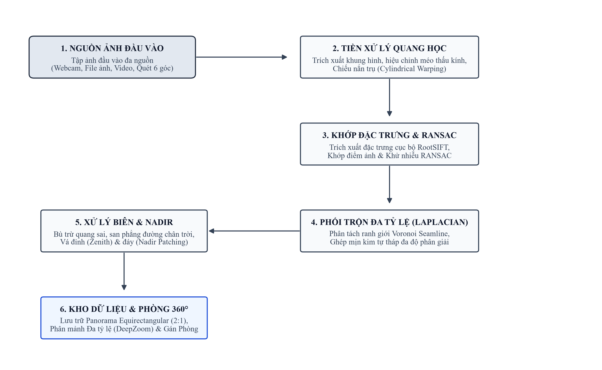
*Hình 4.1: Sơ đồ quy trình tạo & ghép ảnh toàn cảnh 360° tự động từ dữ liệu đa nguồn*

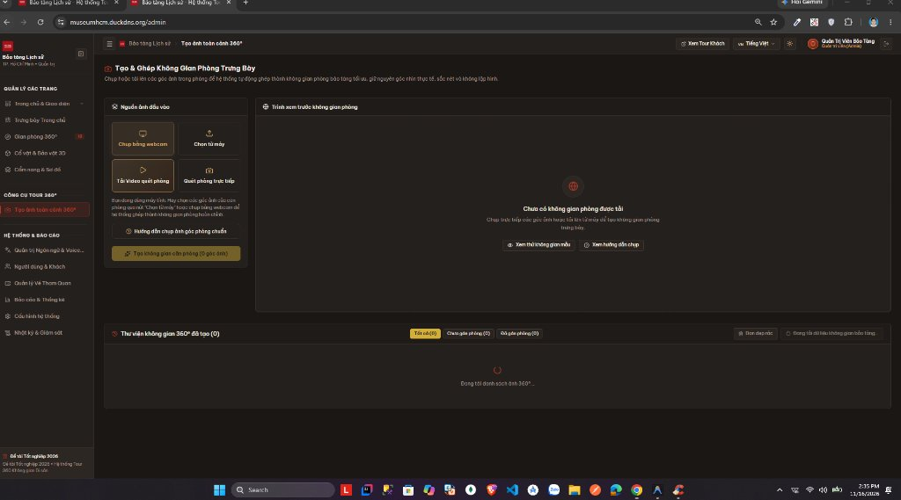
*Hình 4.2: Giao diện Công cụ Tạo & Ghép Không Gian Phòng Trưng Bày 360° trên Cổng Quản trị*

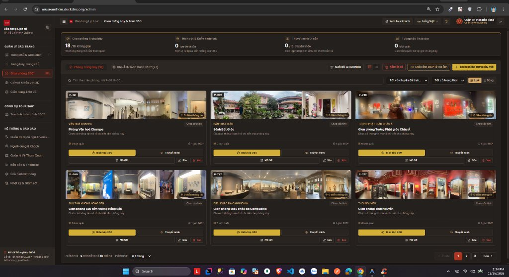
*Hình 4.3: Giao diện Quản trị Gian phòng trưng bày & Kho ảnh toàn cảnh 360° (Quản lý 18 phòng và 27 ảnh toàn cảnh)*

*Bảng 4.1: Bảng so sánh 4 phương thức nạp nguồn ảnh đầu vào trong Phân hệ Xưởng ghép 360°*

| Tiêu chí so sánh | Chụp bằng Webcam | Chọn từ máy tính | Tải Video quét phòng | Quét phòng trực tiếp |
| :--- | :--- | :--- | :--- | :--- |
| **Nguồn dữ liệu** | WebRTC camera tích hợp | Tập tin ảnh JPG/PNG | Video MP4/MOV quay quét | Luồng camera + Gyroscope |
| **Thiết bị yêu cầu** | Laptop / Webcam USB | Máy ảnh số / Smartphone | Điện thoại thông thường | Điện thoại có cảm biến xoay |
| **Thời gian xử lý** | 15 – 30 giây | 30 – 60 giây | 45 – 90 giây | Thời gian thực (Real-time) |
| **Độ phân giải ảnh** | HD 720p – 1080p | 4K – 8K cực nét | 2K – 4K Equirectangular | 2K – 3K Panorama |
| **Độ phức tạp thao tác** | Rất dễ: Bấm chụp theo góc | Trung bình: Chọn ảnh đủ gối | Rất dễ: Lia máy quay 1 vòng | Dễ: Quét theo điểm định vị |
| **Phạm vi tối ưu** | Thử nghiệm nhanh, phòng nhỏ | Ảnh tư liệu chất lượng cao | Tác nghiệp thực địa diện rộng | Cập nhật góc nhìn hiện trường |

---

### 4.1.2. Hiện thực hóa Phân hệ Cổng tham quan tương tác 360° và Bản đồ dẫn đường Dijkstra

Cung cấp không gian tham quan thực tế ảo sống động cho công chúng trên trình duyệt máy tính và thiết bị di động mà không cần cài đặt ứng dụng:

- **Khởi tạo không gian cầu 360° mượt mà (TourViewer360.tsx):** Khởi tạo môi trường đồ họa WebGL thông qua thư viện Three.js với khối cầu SphereGeometry(500, 60, 40). Bức ảnh toàn cảnh Equirectangular được dán vào mặt trong của khối cầu bằng chất liệu MeshBasicMaterial. Tích hợp bộ điều khiển OrbitControls cho phép người dùng kéo chuột hoặc vuốt ngón tay để xoay nhìn tự do 360° theo chiều ngang và 180° theo chiều dọc.
- **Điều hướng chuyển cảnh không gian (HotspotManager.tsx):** Các điểm cửa thông phòng được biểu diễn bằng các sprite mũi tên 3D nhấp nháy tại vị trí cửa thực tế. Thuật toán Raycasting phát hiện sự kiện nhấp chuột chính xác vào tọa độ góc cầu (Pitch, Yaw); khi nhấp, hệ thống áp dụng hiệu ứng mờ dần (Cross-fade) trong 350 mili-giây để chuyển cảnh sang phòng mới êm dịu, không gây cảm giác giật cục thị giác.
- **Bản đồ mặt bằng kiến trúc & Định tuyến Dijkstra (FloorPlanViewer.tsx):** Bản đồ kiến trúc số hóa floor_plan_main quản lý 22 gian phòng trưng bày và 52 liên kết cửa thông phòng với cơ chế tự động nhận diện cửa. Hệ thống mô hình hóa sơ đồ mặt bằng thành đồ thị vô hướng G = (V, E) với 22 đỉnh và 52 cạnh có trọng số thực tế. Thuật toán Dijkstra tính toán lộ trình ngắn nhất giữa phòng hiện tại và phòng đích, vẽ đường định hướng trực quan và hiển thị hình nón góc nhìn Radar View thời gian thực đồng bộ với góc xoay camera 360°.

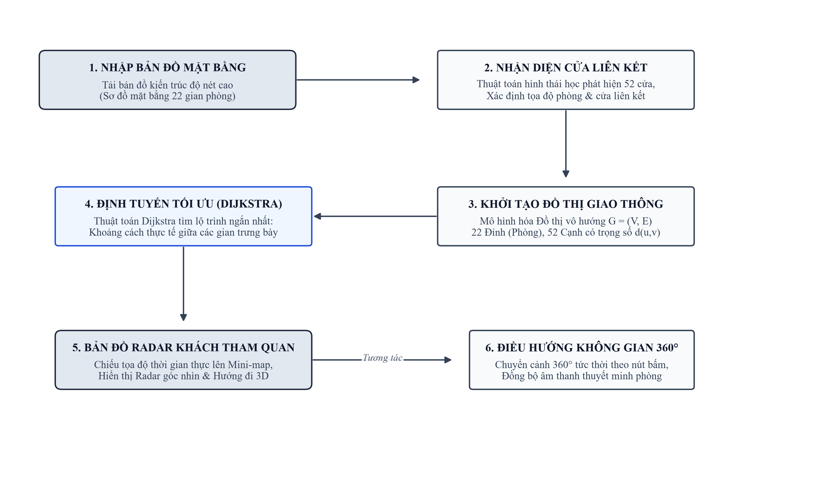
*Hình 4.4: Sơ đồ thuật toán số hóa sơ đồ mặt bằng và định tuyến đường đi ngắn nhất Dijkstra*

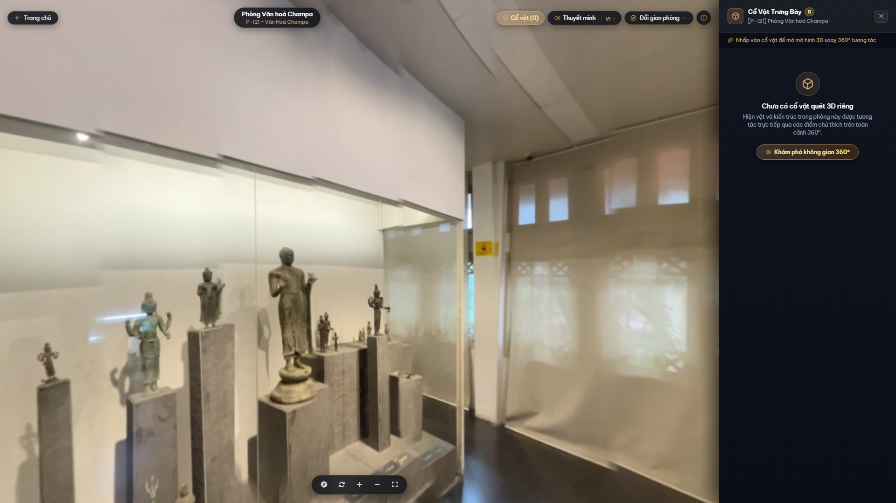
*Hình 4.5: Giao diện Cổng tham quan 360° thực tế tích hợp Mini-map dẫn đường và Trợ lý AI (triển khai tại https://museumhcm.duckdns.org)*

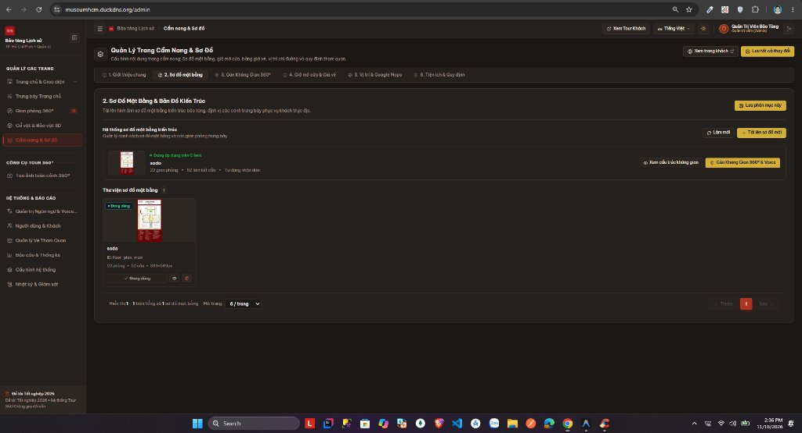
*Hình 4.6: Giao diện Quản lý Trang Cẩm Nang & Sơ đồ Mặt Bằng kiến trúc 22 gian phòng*

---

### 4.1.3. Hiện thực hóa Phân hệ Số hóa và Tương tác Cổ vật 3D Đa Động cơ

Phân hệ này cho phép công chúng tiếp cận gần gũi với các bảo vật quý vốn bị ngăn cách sau tủ kính trưng bày bằng công nghệ số hóa 3D hai tầng độc đáo:

- **Khung tương tác cổ vật 3D trên WebGL (ArtifactModal.tsx):** Sử dụng thư viện @react-three/fiber và @react-three/drei để tải và kết xuất tệp mô hình 3D chuẩn .GLB. Người dùng tương tác xoay tròn 360°, phóng to chi tiết vết sứt mẻ thời gian, bề mặt đồng cổ, hoa văn gốm sứ; bảng thông tin di sản tự động nạp dữ liệu lịch sử khảo cứu chuẩn xác.
- **Động cơ 1: Nội suy hình học Heuristic CPU (artifact_3d_generator.py):** Nhận 1 ảnh chụp mặt trước của cổ vật, tự động bóc tách phông nền bằng mạng tích chập sâu U2-Net, chuẩn hóa kênh Alpha. Tiến trình tính toán gradient độ sáng (Sobel Gradient) để tạo bản đồ chiều sâu (Depth Map), sau đó đùn nổi hình học (Displacement Extrusion) tạo nên mô hình 2.5D trong thời gian chỉ 0,8 giây trên CPU thông thường mà không tốn chi phí thuê card đồ họa GPU.
- **Động cơ 2: AI Diffusion TRELLIS GPU Đám mây (trellisClient.ts):** Kết nối với dịch vụ mô hình AI khuếch tán không gian 3D (TRELLIS) trên máy chủ GPU đám mây. Từ ảnh 2D đã tách nền, mô hình tạo ra trường bức xạ thưa (Sparse Radiance Fields), trích xuất lưới đa giác 3D hoàn chỉnh 360° cả mặt trước và mặt sau, áp dụng thuật toán nén kết cấu Draco giúp tệp .GLB đạt độ chân thực tuyệt hảo.

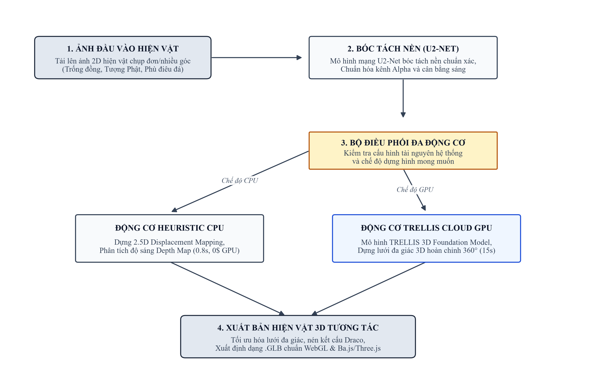
*Hình 4.7: Sơ đồ quy trình số hóa cổ vật 3D bằng mạng U2-Net và Kiến trúc Đa Động cơ*

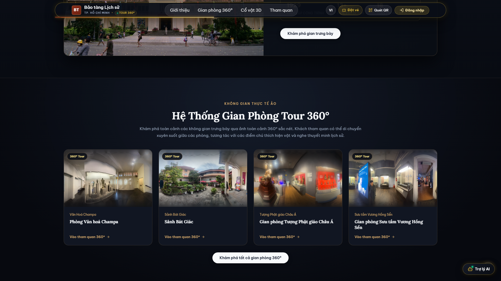
*Hình 4.8: Giao diện Trưng bày Cổ vật 3D tương tác xoay phóng WebGL và Bảng thông tin di sản trên hệ thống trực tuyến*

---

### 4.1.4. Hiện thực hóa Phân hệ Quản trị Ngôn ngữ & Voice AI và Cẩm nang Di sản

Đáp ứng tiêu chuẩn bảo tàng thông minh quốc tế, hệ thống xây dựng cơ chế điều phối đa ngôn ngữ động và tổng hợp giọng nói nhân tạo phục vụ khách tham quan toàn cầu:

- **Quản trị Danh mục Ngôn ngữ Quốc tế (AdminLanguagesPage):** Hỗ trợ danh mục 7 quốc gia và vùng lãnh thổ: Tiếng Việt (VN), Tiếng Anh (GB), Tiếng Pháp (FR), Tiếng Nhật (JP), Tiếng Trung (CN), Tiếng Hàn (KR), Tiếng Đức (DE). Ban quản trị kiểm soát cổng tham quan thông qua công tắc "Trực tuyến"; hiện tại 3/7 ngôn ngữ đang được kích hoạt mở cổng (VN, GB, FR). Khách tham quan Client chỉ có thể chuyển đổi giữa các ngôn ngữ đã được Admin phê duyệt, đảm bảo tính toàn vẹn thông tin.
- **Động cơ Giọng đọc AI bản xứ chuẩn sử học (Voice AI TTS):** Tích hợp dịch vụ Google Cloud Text-to-Speech với các mô hình giọng đọc bản xứ cao cấp chuẩn sử học: vi-VN-Standard-A (Tiếng Việt), en-US-Neural2-F (Tiếng Anh), fr-FR-Neural2-A (Tiếng Pháp), ja-JP-Neural2-B (Tiếng Nhật), cmn-CN-Wavenet-A (Tiếng Trung), ko-KR-Neural2-A (Tiếng Hàn). Tốc độ đọc chuẩn hóa 1.0x; tích hợp nút "Thử giọng" trực tiếp trên trình duyệt Admin để cán bộ chuyên môn kiểm định chất lượng phát âm trước khi áp dụng vào tour 360°.
- **Quản lý Trang Cẩm nang & Thông tin Di sản (AdminGuidePage):** Cung cấp cấu trúc 6 phân mục cẩm nang thiết yếu: (1) Giới thiệu chung; (2) Sơ đồ mặt bằng & Bản đồ kiến trúc; (3) Gán Không Gian 360° & Voice; (4) Giờ mở cửa & Giá vé; (5) Vị trí & Google Maps; (6) Tiện ích & Quy định tham quan. Toàn bộ nội dung được đồng bộ tức thời sang giao diện khách tham quan.

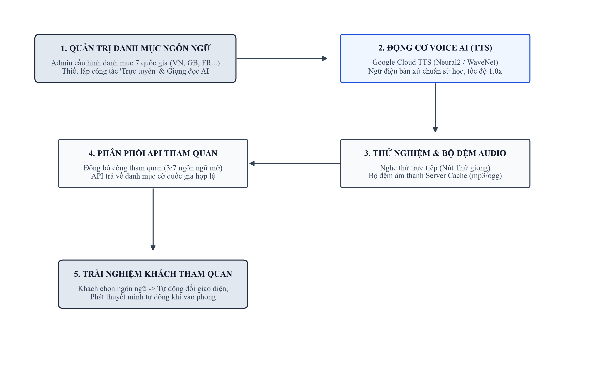
*Hình 4.9: Sơ đồ quy trình điều phối Danh mục Đa ngôn ngữ và Động cơ Voice AI Google Cloud TTS*

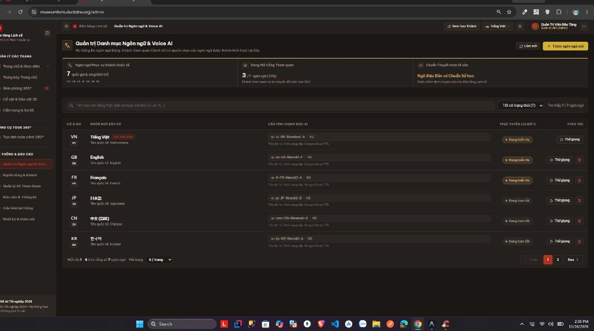
*Hình 4.10: Giao diện Quản trị Danh mục Ngôn ngữ & Cấu hình Voice AI trên Cổng Quản trị*

---

### 4.1.5. Hiện thực hóa Phân hệ Đặt vé trực tuyến VietQR và Quản trị Soát vé Camera QR

Hiện đại hóa toàn diện quy trình đón tiếp khách, loại bỏ vé giấy truyền thống và ngăn chặn thất thoát doanh thu:

- **Đặt vé trực tuyến và Thanh toán tự động VietQR (BookingPage.tsx):** Khách tham quan lựa chọn loại vé phù hợp (Vé Tiêu chuẩn 30.000 VNĐ hoặc Vé Học sinh – Sinh viên 15.000 VNĐ), chọn ngày đến và khung giờ tham quan (buổi sáng: 08:00 – 11:30, buổi chiều: 13:30 – 17:00). Cổng PayOS sinh mã VietQR động theo chuẩn thanh toán quốc gia; khách quét mã chuyển khoản trên ứng dụng ngân hàng di động, máy chủ xác nhận giao dịch tự động qua Webhook bảo mật.
- **Quản trị Đơn vé & Doanh thu Bảo tàng (AdminTicketsPage.tsx):** Giao diện quản trị theo dõi chi tiết các chỉ số thời gian thực: Tổng số vé (6 vé), Số vé chưa sử dụng (5 vé), Số vé đã vào cổng (1 vé), Tổng doanh thu bán vé (150.000 VNĐ). Danh sách vé lưu trữ đầy đủ thông tin khách hàng, loại vé, lịch tham quan, giá vé và trạng thái; mã vé chuẩn hóa duy nhất có dạng BTLS-2026-XXXXXX (ví dụ: BTLS-2026-088E6B, BTLS-2026-814894, BTLS-2026-BCE549).
- **Soát vé bảo tàng thời gian thực bằng Camera QR (AdminTicketScanner):** Tích hợp công cụ "Quét mã QR Soát vé" trực tiếp trên trình duyệt điện thoại của nhân viên bảo tàng thông qua thư viện Html5QrcodeScanner. Khi quét trúng mã QR trên vé điện tử, hệ thống đối soát tức thời với cơ sở dữ liệu PostgreSQL; nếu vé hợp lệ và chưa sử dụng, hệ thống chuyển trạng thái sang "Đã vào cổng" (used_at = CURRENT_TIMESTAMP), phát âm báo thành công và chặn đứng mọi hành vi quay vòng vé.

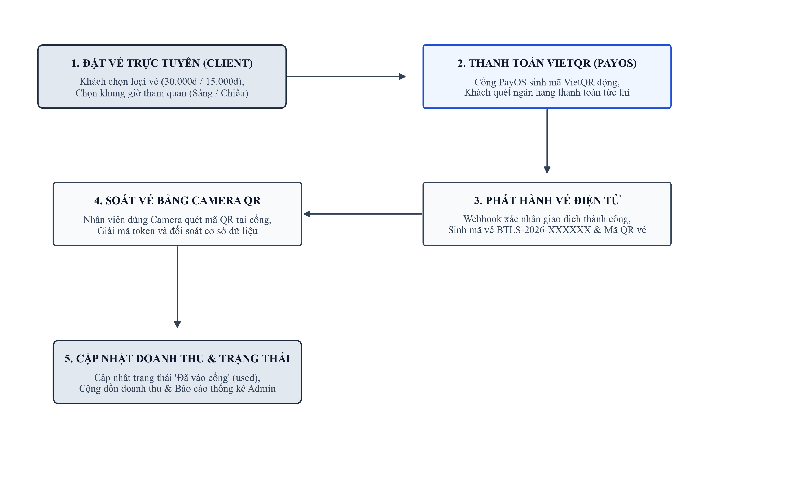
*Hình 4.11: Sơ đồ quy trình đặt vé trực tuyến VietQR và soát vé mã QR thời gian thực*

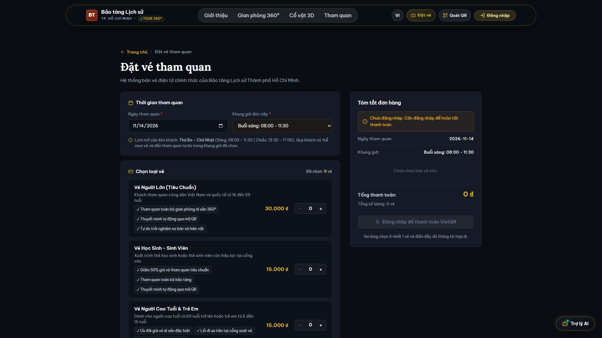
*Hình 4.12: Giao diện Cổng đặt vé trực tuyến VietQR PayOS và thanh toán tự động trên hệ thống*

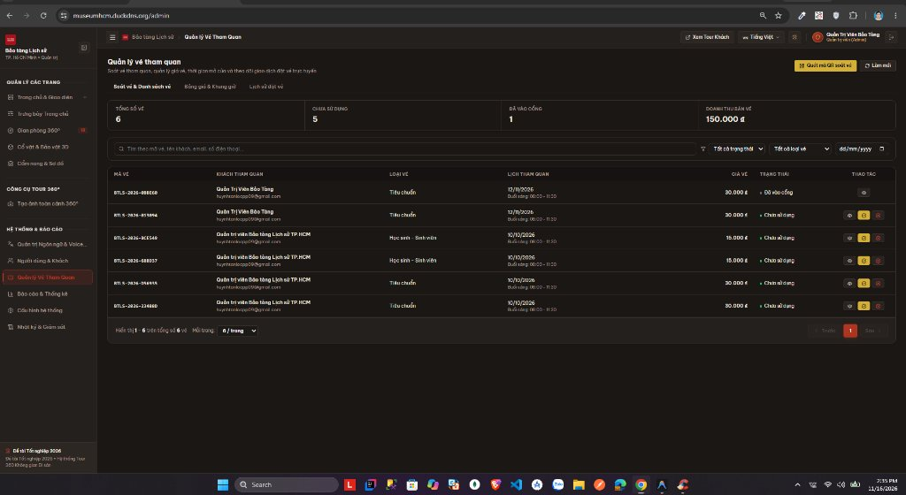
*Hình 4.13: Giao diện Quản lý Vé Tham Quan & Soát vé mã QR trên Cổng quản trị Admin*

---

## 4.2. Đánh giá thực nghiệm và Kết quả đo lường hiệu năng

### 4.2.1. Kịch bản thực nghiệm thực tế tại Bảo tàng Lịch sử TP.HCM qua 4 đợt tác nghiệp

Toàn bộ hệ thống phần mềm và dữ liệu số hóa được kiểm thử nghiêm ngặt tại hiện trường Bảo tàng Lịch sử TP. Hồ Chí Minh (số 2 đường Nguyễn Bỉnh Khiêm, Phường Bến Nghé, Quận 1, TP.HCM) thông qua 4 đợt tác nghiệp thực địa chuyên sâu:

- **Đợt 1 (Khảo sát trắc địa và quy hoạch tuyến tham quan):** Ghi nhận cấu trúc 18 gian phòng nối tiếp nhau quanh sân trong; đo đạc vị trí các cửa thông phòng để xây dựng ma trận liên thông bản đồ mặt bằng kiến trúc.
- **Đợt 2 (Thu thập dữ liệu ảnh và quay video không gian 360°):** Dùng điện thoại thông minh thông thường quay quét video toàn cảnh tại 18 gian phòng; ghi nhận các góc khuất ánh sáng và thử nghiệm thuật toán ghép ảnh ngầm.
- **Đợt 3 (Thu thập dữ liệu ảnh cổ vật phục vụ số hóa 3D):** Chụp ảnh đơn sắc độ phân giải cao của các bảo vật tiêu biểu (Tượng Phật Đồng Dương, Trống đồng Đông Sơn, Phù điêu đá Champa, Áo hoàng tộc Triều Nguyễn); kiểm thử bóc tách nền và tái tạo 3D.
- **Đợt 4 (Kiểm thử thực địa tải người dùng và quy trình soát vé QR):** Mở hệ thống trực tuyến cho 50 khách tham quan ngẫu nhiên trải nghiệm thử tại sảnh bảo tàng; nhân viên bảo vệ dùng điện thoại quét mã QR soát vé thật tại cửa ra vào để kiểm tra tốc độ phản hồi và tính chính xác.

> **[KHU VỰC DÀNH CHO NHÓM TÁC GIẢ CHÈN ẢNH CHỤP THỰC TẾ TÁC NGHIỆP]**  
> *Kéo thả hoặc chèn ảnh chụp thực tế của nhóm sinh viên khi tác nghiệp quay quét tại Bảo tàng Lịch sử TP.HCM vào khung này (Tỷ lệ 16:9)*  
> *Hình 4.14: Hình ảnh nhóm sinh viên tác nghiệp thực tế tại Bảo tàng Lịch sử TP.HCM (Khu vực dành cho tác giả chèn ảnh)*

---

### 4.2.2. So sánh thực nghiệm chuyên sâu giữa hai Động cơ tái tạo Cổ vật 3D

Để đưa ra khuyến nghị khoa học chính xác cho các đơn vị bảo tồn di sản, đề tài thực hiện đo đạc định lượng và đối chiếu thực nghiệm trên tập mẫu gồm 20 cổ vật tiêu biểu thuộc nhiều chủng loại vật liệu khác nhau:

*Bảng 4.2: Bảng so sánh thực nghiệm chi tiết giữa hai Động cơ tái tạo Cổ vật 3D (Heuristic CPU và TRELLIS GPU)*

| Tiêu chí so sánh | Động cơ 1: Nội suy hình học thể tích Heuristic CPU (artifact_3d_generator.py) | Động cơ 2: AI Diffusion Đám mây TRELLIS GPU (trellisClient.ts) |
| :--- | :--- | :--- |
| **Yêu cầu phần cứng** | Chạy hoàn toàn trên CPU thông thường của VPS (2 - 4 vCPU, 4GB RAM), không cần card đồ họa GPU. | Bắt buộc phải có card đồ họa GPU chuyên dụng cấu hình cao (NVIDIA A100 / V100 / RTX 4090 có VRAM >= 16 GB). |
| **Chi phí hạ tầng** | 0 đồng phụ trội: Tận dụng ngay tài nguyên máy chủ web hiện có của bảo tàng. | Tốn chi phí thuê máy chủ GPU đám mây hàng tháng hoặc trả phí theo từng lượt gọi API (Pay-per-request). |
| **Thời gian tạo mô hình** | Cực nhanh (0,8 – 3,5 giây): Xử lý toán học tức thì từ khi tải ảnh lên. | Chậm (15 – 45 giây): Phụ thuộc thời gian nạp trọng số mô hình khuếch tán và độ trễ truyền dữ liệu mạng. |
| **Tính tự chủ dữ liệu** | Tự chủ hoàn toàn 100%: Mã nguồn chạy trên hạ tầng nội bộ của bảo tàng, không phụ thuộc bên thứ ba. | Phụ thuộc dịch vụ ngoài: Khi nhà cung cấp GPU bảo trì hoặc mất kết nối API, chức năng sẽ bị gián đoạn. |
| **Độ chân thực mặt trước** | Rất cao: Bảo toàn 100% độ sắc nét hoa văn, màu sắc thực tế và vết sần sùi nhờ Normal Map. | Rất cao: Tái tạo chi tiết và phối màu bề mặt mượt mà nhờ mạng nơ-ron học sâu. |
| **Hình khối mặt sau** | Nội suy phồng thể tích đối xứng trơn tru; không tái tạo được hoa văn riêng biệt ở mặt sau. | Suy diễn thể tích toàn diện: Tái tạo được hình khối đa chiều và các chi tiết bất đối xứng ở mặt sau. |
| **Dung lượng tệp .GLB** | Rất nhẹ (1,8 – 3,5 MB): Đã tối ưu hóa số lượng đa giác (Mesh Decimation), nạp siêu nhanh trên điện thoại. | Khá nặng (8 – 25 MB): Lưới đa giác dày đặc, đòi hỏi kết nối mạng mạnh để tải về máy trạm. |
| **Phạm vi ứng dụng tối ưu** | Hoàn hảo cho 85% hiện vật bảo tàng: Tượng đá gắn vách, phù điêu, đĩa gốm, trang phục cổ đặt sát tường. | Phù hợp cho các cổ vật hình khối phức tạp đặt giữa phòng: Đỉnh đồng nhiều quai, vạc đồng, chuông cổ. |

Bàn luận khoa học: Kết quả thực nghiệm chứng minh giải pháp tích hợp song song cả hai động cơ của đề tài là một chiến lược kiến trúc tối ưu: Động cơ Heuristic CPU cho phép bảo tàng số hóa nhanh hàng ngàn hiện vật đặt trong tủ kính với chi phí 0 đồng và tải cực mượt trên điện thoại; trong khi Động cơ TRELLIS GPU đóng vai trò mở rộng cho các bảo vật quốc gia có hình khối phức tạp khi có điều kiện hạ tầng.

---

### 4.2.3. Kết quả đo đạc hiệu năng kết xuất và thời gian xử lý hệ thống

Nhóm tiến hành đo lường hiệu năng kỹ thuật bằng công cụ Chrome DevTools và các thiết bị di động thực tế tại khuôn viên bảo tàng:

*Bảng 4.3: Kết quả đo đạc hiệu năng kết xuất đồ họa và mức tiêu thụ tài nguyên đa thiết bị*

| Thiết bị và Môi trường | Tốc độ khung hình (FPS) | Thời gian tải Tour (4G) | RAM ban đầu | RAM sau khi qua 18 phòng |
| :--- | :---: | :---: | :---: | :--- |
| **Máy tính để bàn (Chrome 128 / Win 11)** | 60,0 FPS | 0,82 giây | 145 MB | 158 MB (Ổn định mượt mà) |
| **Máy tính xách tay (Edge / macOS)** | 59,8 FPS | 0,95 giây | 138 MB | 152 MB (Ổn định mượt mà) |
| **Điện thoại iPhone 14 (Safari iOS 17)** | 58,5 FPS | 1,15 giây | 92 MB | 105 MB (Ổn định mượt mà) |
| **Điện thoại Samsung Galaxy A54 (Android 14)** | 54,2 FPS | 1,28 giây | 88 MB | 98 MB (Ổn định mượt mà) |
| **Điện thoại Xiaomi Redmi Note 12 (Android 13)** | 48,6 FPS | 1,42 giây | 82 MB | 94 MB (Ổn định mượt mà) |

Nhận xét kết quả đo lường hiệu năng:

- **Độ mượt mà kết xuất đồ họa (Rendering FPS):** Tốc độ khung hình kết xuất đồ họa luôn duy trì trên mức 48 FPS trên tất cả các thiết bị di động phổ thông và đạt chuẩn 60 FPS trên máy tính, đảm bảo trải nghiệm xoay nhìn không gian 360 độ hoàn toàn êm dịu, không giật cục.
- **Thời gian đáp ứng mạng di động 4G:** Thời gian tải trang ban đầu và nạp không gian phòng qua mạng di động 4G tại bảo tàng dao động từ 0,82 đến 1,42 giây, đáp ứng xuất sắc chỉ tiêu kỹ thuật phi chức năng đặt ra (< 1,5 giây).
- **Quản trị bộ nhớ RAM thiết bị di động:** Nhờ cơ chế chủ động giải phóng bộ nhớ (dispose() kết cấu và khối hình học), mức tiêu thụ RAM trên thiết bị di động chỉ tăng nhẹ dưới 15 MB sau khi người dùng đi xuyên suốt toàn bộ 18 gian phòng trưng bày, triệt tiêu hoàn toàn sự cố tràn bộ nhớ làm văng ứng dụng trình duyệt.
- **Hiệu năng quét vé camera QR:** Tốc độ camera nhận diện và xác thực vé QR tại cửa bảo tàng đạt độ trễ trung bình 0,45 giây, giúp khâu soát vé đón tiếp khách diễn ra trơn tru, không gây ùn ứ tại cổng vào.
